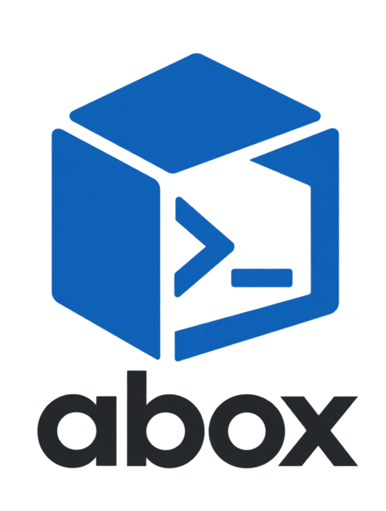

<p align="center">
  <picture>
    <source media="(prefers-color-scheme: dark)" srcset="docs/assets/logo-dark.png">
    
  </picture>
</p>

# abox - Agent Sandbox Manager

[](https://github.com/spacy-cloud/agent-box/actions/workflows/ci.yml)
[](LICENSE)

Local sandboxes for AI agents. Describe an environment once as a template, then create, use and
remove it from the **CLI**, an **MCP server** or an **Electron GUI**, under a policy that you
control and the agent cannot change.

_Deutsche Kurzfassung: [README.de.md](README.de.md)._

> [!WARNING]
> **Status: pre-release (release candidate work).** Nothing has been published yet: there are no
> packages on npm, no published AppImage and no tagged release. The CLI, the MCP server, five backends, the
> Claude Code plugin and the desktop app are implemented in this repository, but APIs, JSON output
> and file formats are **not stable** and will change. What is not verified is listed in
> [docs/security.md](docs/security.md#known-limitations-and-not-verified).

> [!CAUTION]
> **Security notice.** Containers share the host kernel. abox reduces risk with hardened defaults,
> path checks, an approval workflow and an egress proxy, but it is **not a substitute for a
> reviewed security architecture**. Do not run code you cannot afford to lose control of on an
> isolation level that is too weak for it. Read [docs/security.md](docs/security.md), including
> the list of known limitations, before relying on abox.

## What abox is

abox manages **sandboxes** for AI agents such as Claude Code or other MCP clients. A sandbox is an
isolated place where an agent can run commands and change files without touching the rest of your
machine.

- **Backend-neutral.** The core model (template, sandbox, isolation level, workspace, policy)
  does not use container vocabulary. Docker/Podman containers, host processes, Python
  environments and VMs are interchangeable backends behind one interface, and all of them have to
  pass the same contract test suite.
- **Agent control first.** MCP tools, a policy with approval workflow and skills for coding
  agents are core features, not add-ons. Enforcement happens in the core: a CLI call, an MCP call
  and a GUI click go through the same checks.
- **The host decides.** An agent can request rights. It cannot change the policy or the approval
  mode, and it cannot approve its own requests.
- **Local-first, no telemetry.** abox does not phone home, does not collect usage data and needs
  no account or cloud service. See [No telemetry](#no-telemetry).
- **Honest about limits.** Every isolation level documents what it does and does not protect
  against.

## Features by component

| Component          | Description                                                                                                                              | Status                                                                                                                                                     |
| ------------------ | ---------------------------------------------------------------------------------------------------------------------------------------- | ---------------------------------------------------------------------------------------------------------------------------------------------------------- |
| Core (`core`)      | domain model, template engine, lifecycle, policy and approvals, audit log, SQLite state                                                  | implemented                                                                                                                                                |
| Skill catalog      | `SKILL.md` folders (built-in, user, project) chosen per template and per sandbox, copied read-only to `/skills` with an index            | implemented; verified against Docker and the process backend, **not** on the VM backend, see [skills](docs/skills.md)                                      |
| Docker backend     | OCI containers through the engine API, hardened defaults, egress proxy sidecar                                                           | implemented; tested against a rootful Docker engine                                                                                                        |
| Podman backend     | same code, Podman's Docker-compatible socket                                                                                             | implemented; **not verified** against a real Podman                                                                                                        |
| Python backend     | container with `uv` (lock file baked into the image), or a host venv (no isolation)                                                      | implemented                                                                                                                                                |
| VM backend         | QEMU/KVM virtual machine with its own kernel, cloud images with checksum verification                                                    | implemented; needs `/dev/kvm`, x86_64                                                                                                                      |
| Process backend    | host process without isolation (level `none`), clearly marked; reference for the contract tests                                          | implemented                                                                                                                                                |
| CLI (`abox`)       | thin layer over the core, text or `--json` output, shell completion                                                                      | implemented                                                                                                                                                |
| MCP server         | Tools ([catalog](docs/mcp-catalog.md)) over stdio and local HTTP with token authentication, resources and a prompt                       | implemented                                                                                                                                                |
| Agent setup        | `abox setup`: registers the MCP server and rules with Claude Code, Claude Desktop, Codex, Cursor, Gemini CLI; preview, backup, uninstall | implemented; tested on fixture configs; Cursor, Gemini CLI, macOS and Windows paths **not verified** on a real install, see [setup](docs/setup.md)         |
| Claude Code plugin | `agent-kit`: decision skill, slash commands, subagent, optional hook, marketplace                                                        | implemented; skill triggering checked headless only (single samples), slash commands untested                                                              |
| Electron GUI       | overview, sandboxes, templates, hosts, approvals, audit, policy, terminal, first-run setup                                               | implemented; e2e tests pass under xvfb; AppImage builds locally; unreleased                                                                                |
| Hosts and SSH      | sandboxes on a remote machine over SSH (agentless), host profiles, zones, host-key pinning                                               | implemented, experimental; verified only against a local sshd container                                                                                    |
| Orca plugin        | commands and a launcher panel for the Orca IDE                                                                                           | implemented; not tested in a running Orca                                                                                                                  |
| Packaging          | npm packages, AppImage, AUR (`abox-git`)                                                                                                 | AppImage builds from source (`pnpm --filter @abox/app dist`); AUR `PKGBUILD` written; npm planned; nothing published, see [packaging](packaging/README.md) |

Highlights of the design:

- **Templates** in YAML describe base OS, packages, tools, resources, network and mounts.
  Project templates from a repository are untrusted until you approve their content hash.
- **Skills** (folders with a `SKILL.md`, the Claude Code / Agent Skills format) are picked per
  template and per sandbox and copied read-only to `/skills` with an index, so an agent reads only
  what it needs. Project skills are trusted by content hash like project templates.
- **Isolation levels** `none`, `container`, `hardened`, `vm`. Templates and policy can demand a
  minimum level. `hardened` (a stronger container runtime) is not verified.
- **Network modes** `none` (default), `allowlist` (domain allowlist via an egress proxy) and
  `open`.
- **Previews** forward a dev server of a sandbox (Vite, Flutter web, `php -S`) to `127.0.0.1`
  only (`abox port add`); the sandbox gets no new way out, and agents need your approval.
- **Secrets** stay in the host keyring. With `inject: proxy` the proxy adds the credential to
  requests and the sandbox never sees it.
- **Workspace modes** `mount`, `clone`, `worktree`, `copy`, `empty` (and `sync` for remote
  hosts); an empty workspace unless you pass one. Results come back through an explicit export; nothing is merged into the original
  project automatically. You can review the changes side by side and take over single files or hunks
  yourself (GUI **Changes** tab, `abox apply`): human only, all-or-nothing, flagged files need an extra
  confirmation.
- **Audit log** is append-only and hash-chained.

## Requirements

- Linux (the only supported platform). macOS and Windows are not supported.
- Docker or Podman (rootless recommended) for the container backends; `/dev/kvm` and QEMU for the
  VM backend; `secret-tool` (libsecret) for keyring-backed secrets; OpenSSH for remote hosts.
- Node.js >= 24 and pnpm 10 (the exact version is pinned in `packageManager` in `package.json`).

## Quick install from source

There is no release yet, so building from source is the only way to try abox.

```sh
git clone https://github.com/spacy-cloud/agent-box.git
cd agent-box
pnpm install
pnpm build
mkdir -p ~/.local/bin && ln -sf "$PWD/packages/cli/dist/bin.js" ~/.local/bin/abox
abox doctor                                    # what works on this machine
abox doctor --for flutter-dev                  # can I run this template (or host:<id>)?
abox create alpine-min --name scratch          # an empty sandbox
abox exec scratch -- sh -c 'echo hello'
abox rm -f scratch
abox setup                                     # connect Claude Code, Codex, Cursor, ... (preview, backup)
```

The [quickstart](docs/quickstart.md) walks through this in detail. Tests:

```sh
pnpm test         # unit, contract and security tests (no container engine needed)
pnpm test:docker  # additionally runs the integration tests against a real Docker/Podman engine
```

`pnpm test:docker` sets `ABOX_TEST_DOCKER=1` and creates and removes real containers and networks
(all labelled `abox.*`). See [CONTRIBUTING.md](CONTRIBUTING.md) for the test levels.

## Repository layout

| Path                       | Package (internal name) | Purpose                                                          |
| -------------------------- | ----------------------- | ---------------------------------------------------------------- |
| `packages/core`            | `@abox/core`            | Domain model, templates, lifecycle, policy, audit, state         |
| `packages/backend-docker`  | `@abox/backend-docker`  | Docker/Podman backend                                            |
| `packages/backend-process` | `@abox/backend-process` | Host-process backend (isolation `none`)                          |
| `packages/backend-python`  | `@abox/backend-python`  | Python backend (container with uv, or host venv)                 |
| `packages/backend-vm`      | `@abox/backend-vm`      | VM backend (QEMU/KVM)                                            |
| `packages/contract-tests`  | `@abox/contract-tests`  | Contract suite every backend must pass                           |
| `packages/proxy`           | `@abox/proxy`           | Egress proxy sidecar (allowlist, secret injection)               |
| `packages/cli`             | `@abox/cli`             | The `abox` command                                               |
| `packages/mcp`             | `@abox/mcp`             | MCP server                                                       |
| `packages/runtime`         | `@abox/runtime`         | Wires the manager, backends, hosts and keyring for every surface |
| `packages/e2e`             | `@abox/e2e`             | End-to-end and security tests against a real engine              |
| `packages/app`             | `@abox/app`             | Electron GUI (unreleased)                                        |
| `packages/agent-kit`       | -                       | Claude Code plugin: skills, commands, `.mcp.json`                |
| `packages/orca-plugin`     | -                       | Orca plugin manifest, worker and panel                           |
| `docs/`                    | -                       | user documentation, see below                                    |
| `packaging/`               | -                       | AUR package and packaging notes                                  |

Package names: the npm name `abox` is already taken by another project, so published packages will
use the `@spacy-cloud/` scope. The command-line binary is called `abox`. The `@abox/*` names above
are internal workspace names.

## Documentation

- [Quickstart](docs/quickstart.md): install from source, first sandbox, workspace modes, approvals, connecting an agent.
- [Template handbook](docs/templates.md): every field, defaults, presets, validation, trust, examples.
- [Skills](docs/skills.md): the `SKILL.md` format, where skills live, trust, policy and what an agent finds in `/skills`.
- [CLI reference](docs/cli.md): all commands, JSON output, exit codes, files.
- [MCP server](docs/mcp.md): transports, identity, tokens, the approval flow; the [tool catalog](docs/mcp-catalog.md) and the [error catalog](docs/errors.md) are generated from the code.
- [Setting up agents](docs/setup.md): `abox setup` registers the MCP server and rules with Claude Code, Claude Desktop, Codex, Cursor and Gemini CLI.
- [Claude Code and other agents](docs/claude-code.md): the `agent-kit` plugin, rule snippets, Codex, Cursor, Orca.
- [Backends](docs/backends.md): docker, podman, python, vm, process; capabilities and what is verified.
- [Hosts and SSH](docs/hosts-ssh.md): remote hosts, zones, preparing a server.
- [Desktop app](docs/gui.md): views, approvals, keyboard use, app security.
- [Troubleshooting](docs/troubleshooting.md): `abox doctor`, common errors, resetting `ABOX_HOME`.
- [Architecture](docs/architecture.md) and [security model](docs/security.md), including
  [known limitations](docs/security.md#known-limitations-and-not-verified).
- [Packaging](packaging/README.md), [Contributing](CONTRIBUTING.md), [Security policy](SECURITY.md),
  [Code of conduct](CODE_OF_CONDUCT.md), [Changelog](CHANGELOG.md).

## No telemetry

abox collects no telemetry and sends no usage data, crash reports or identifiers anywhere. It
makes network requests only when you ask it to: pulling environment images, installing packages
during template builds, or traffic from inside a sandbox that your template and policy allow.
The audit log stays on your machine.

## Security reporting

Please report vulnerabilities privately through GitHub Private Vulnerability Reporting, not in
public issues. See [SECURITY.md](SECURITY.md).

## License

[MIT](LICENSE) - Copyright (c) 2026 SPACY.CLOUD and abox contributors.
